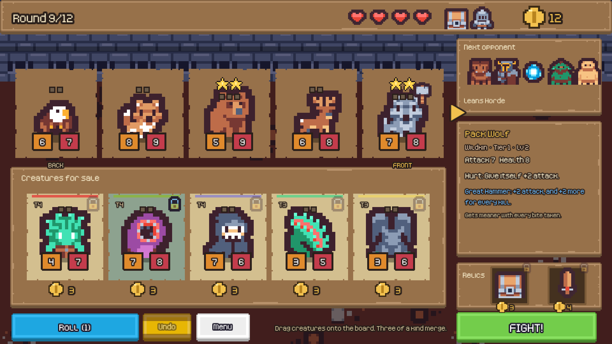
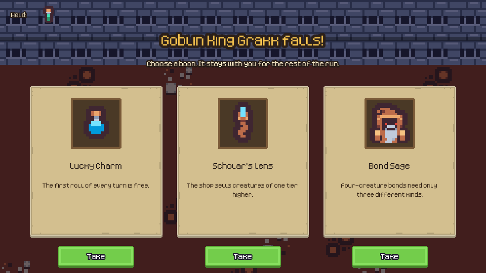
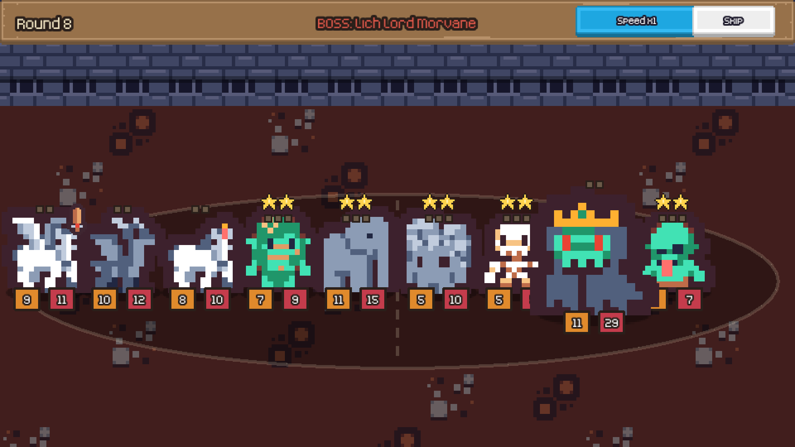
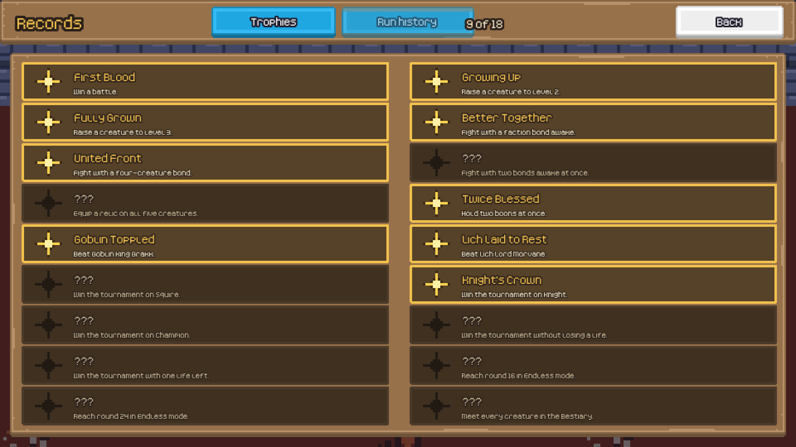
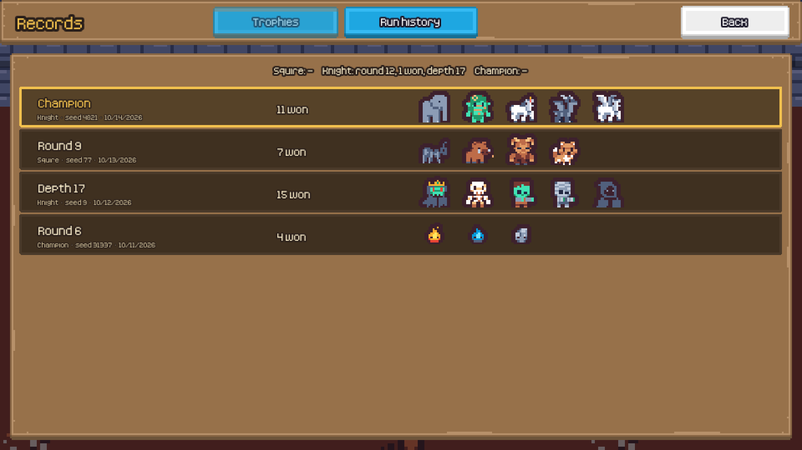

# Beast Tourney

[](https://github.com/ducampcarlos/beast-tourney/actions/workflows/ci.yml)

[](LICENSE)
[](CREDITS.md)

**A fantasy creature auto-battler for the browser.** Buy beasts, merge copies into stronger forms, awaken faction bonds, equip relics, win boons from the bosses, then watch your team fight through a 12-round tournament, and keep descending in Endless mode if you survive. Pixel art, music, touch and mouse, installable, playable offline.

<p align="center"></p>

> **Play it:** `https://ducampcarlos.github.io/beast-tourney/` once GitHub Pages is switched on for this repository (Settings → Pages → Deploy from a branch → `main` / `docs`). Or run it locally in a minute, see below.

## How it plays

Each turn you get 10 gold. Spend it in the shop, then press **Fight**: the two teams clash front against front, automatically, and the animations play out every blow, ability and fall.

- **Buy and place.** Drag a creature (3 gold) onto your board of five slots, or double-click it. Roll for new offers (1 gold). Freeze an offer with its padlock to keep it for next turn. Sell by dragging onto the shop. **Undo** takes back the last move of the turn.
- **Merge.** Drop a creature onto another of the same kind: it grows +1/+1 and absorbs its experience. Three copies make a **level 2** (22 creatures evolve into a new sprite, and every ability number doubles), six make a **level 3**.
- **Bond.** Field 2 or 4 *different* creatures of the same faction for a team-wide bonus. Seven factions: the pack-hunting **Wildkin**, the resurrecting **Undead**, shielded **Elementals**, ever-growing **Fae**, fire-breathing **Dragonkin**, gold-hoarding **Horde** and the well-equipped **Order**.
- **Equip.** Thirteen relics, one per creature: a barrier, venom, a returning phoenix tear, thorns, a rallying blade, a hammer that grows with every kill.
- **Fight.** Abilities fire at battle start, when hurt, on a kill, on fainting, when an ally faints, and, in the shop, on sell and at the start of a turn. A **barrier** cancels the next hit; **venom** makes a creature's attacks lethal.
- **Choose a boon.** Beat the bosses of rounds 4 and 8 and pick one of three rewards for the rest of the run: a heavy purse, a free reroll, a shop that sells a tier higher, bonds that need one creature fewer, a barrier for your front line, a phoenix ember... Twelve in all, and they change what a run is about.
- **Survive.** Beat the Goblin King, the Lich Lord and the Elder Dragon, and lose no more lives than your rank allows. Then, if you dare, **descend**: Endless mode keeps the round counter going, the enemies growing 8% stronger each round and the three bosses coming back *Reborn*.

<p align="center"> </p>

**Everything else:** 55 creatures with flavour text and three levels each; a **Bestiary** that fills in as you meet them, with every faction's bonds; 18 **trophies** and a **run history** that remembers your teams; three ranks (Squire, Knight, Champion); a **Daily Run** with the same seed for everybody; saves you can resume after closing the tab; hover any enemy to see what you are about to fight; speed control and skip in battle; settings for music, effects and default speed; and a layout that fits any screen. It can be **installed** like an app and **plays offline** after the first visit.

<p align="center"> </p>

| Controls | |
| --- | --- |
| Drag and drop | buy, move, merge, sell, equip |
| Double-click / double-tap an offer | quick buy |
| `R` | roll |
| `Z` | undo |
| `F` | fight |
| `M` | mute |
| `Space` in battle | cycle speed (x1, x2, x4) |
| `Esc` in battle | skip to the result |

## Run it

```bash
git clone https://github.com/ducampcarlos/beast-tourney.git
cd beast-tourney
npm ci
npm run dev        # builds, watches and serves http://localhost:8000
```

`npm run build` writes `docs/game.js` and `docs/precache.json` (the file list the service worker keeps for offline play); the rest of `docs/` is the site itself, which is why GitHub Pages can serve it as it is. URL options: `?seed=1234` makes **New Run** use that seed (the same seed always deals the same shops and meets the same opponents), `?debug` exposes the game to the tests, `?nohelp` skips the first-run panel. The dev server runs on `localhost`, where the service worker is deliberately off.

## How it is built

```
src/engine/   the rules: pure TypeScript, no Phaser, no DOM, no clock
  data.ts       55 creatures, 7 factions with their bonds, 13 relics, 12 boons, bosses
  battle.ts     the fight: effects, triggers, statuses, bonds, boons, revival; returns an event log
  run.ts        the shop, merging, gold, boons, the ladder and Endless mode; every command returns a new state
  enemy.ts      opponents, generated from the seed and scaled to a power curve
  achievements.ts  trophies as pure rules over facts
  save.ts       saves, validated field by field on load
src/web/      the Phaser 3 client: scenes (menu, shop, battle, boon, end, bestiary, records), drag and drop, effects, audio
src/sim/      bots that play full runs, and the balance report
docs/         the site GitHub Pages serves: index.html, assets, the built game.js, the service worker
```

- **The engine knows nothing about drawing.** A battle comes back as a list of events (`clash`, `damage`, `buff`, `faint`, `summon`...) with a snapshot of both teams after each step, and the battle scene simply replays it: tweens, projectiles, floating numbers, particles. That is also what makes everything below testable without a browser.
- **Deterministic.** The seed fixes the shops, the opponents, the boon choices and every random target in every fight. Commands never mutate their input, so a run can be undone, replayed, saved or shared as a seed.
- **Opponents are generated, not recorded.** There is no server, so each round's enemy team is picked from the seed and then *scaled to a target power curve* (the sum of attack and health), with bosses as fixed casts. A lucky draw of high-tier creatures cannot spike a round, and in Endless mode the curve simply keeps climbing.
- **Balanced with data, not by feel.** `npm run balance` plays thousands of full runs with a bot and prints win rates per rank, how far runs get and how each creature and faction performs. That is how the power curve was set (twice: boons made every rank about ten points easier), how the Fae were taken down a peg (they were winning 61-75% of their battles), how summoners that never had room to summon were found, and how Horde and Order were nudged toward the middle. Over 4000 runs per rank, a decent bot wins the tournament about **58% of the time on Squire, 19% on Knight and 4% on Champion**. The balance tests pin those bands so a content change cannot quietly break them.
- **Works offline.** The build lists every file of the site; the service worker downloads them once and the game runs with no connection. A new deploy changes the list's version and replaces the old cache.

## Tests

```bash
npm test            # 148 tests: rules, shop, boons, Endless, enemies, trophies, saves, content, bots, balance bands
npm run test:e2e    # 38 end-to-end tests in a real Chromium (needs: npm run build)
```

The unit tests cover every ability trigger and effect, each status, each bond, each of the twelve boons, merging and levelling, selling, freezing, relics, the whole ladder (including losing the final and drawing), Endless mode, determinism, and save tampering (dozens of kinds of impossible values are refused, and saves from before a feature existed still load). A fuzz test throws up to 6,000 random commands at the shop and 1,500 random fights at the battle engine and checks the invariants hold. The end-to-end tests drive the real built game with a real mouse and a real finger: dragging to buy, merge, sell and equip, undo, double-tap, a battle played in real time, a lost run, a won tournament, Endless mode, choosing boons, resuming after a reload, a corrupted save, the settings, trophies, a canvas from phone to 1080p, going offline after the first visit, and a "monkey" that clicks, drags and types at random for hundreds of actions without a single error. Writing them found real bugs, among them a second boon that could not be taken because a scene kept its state between visits.

## Limitations

- Opponents are generated, there is no online play and no leaderboard.
- Tested in Chromium. Firefox and Safari should work (Phaser supports them) but have not been run through the suite.
- The layout is landscape first. On a phone held upright the game is small and asks you to turn it sideways.
- Browsers keep audio silent until the first click or tap.
- The balance numbers are for a scripted bot, which plays the shop and picks boons by fixed rules; people will do better (and worse in different ways).

## Credits and license

The code is MIT. The art, fonts, sound effects and music are all CC0 and come from [Kenney](https://kenney.nl) and [OpenGameArt](https://opengameart.org); [CREDITS.md](CREDITS.md) lists every pack, its author and its page. No Pokémon or other trademarked characters appear in this project: the creatures, names and abilities are original, which also means it can stay public without a takedown notice waiting for it.
