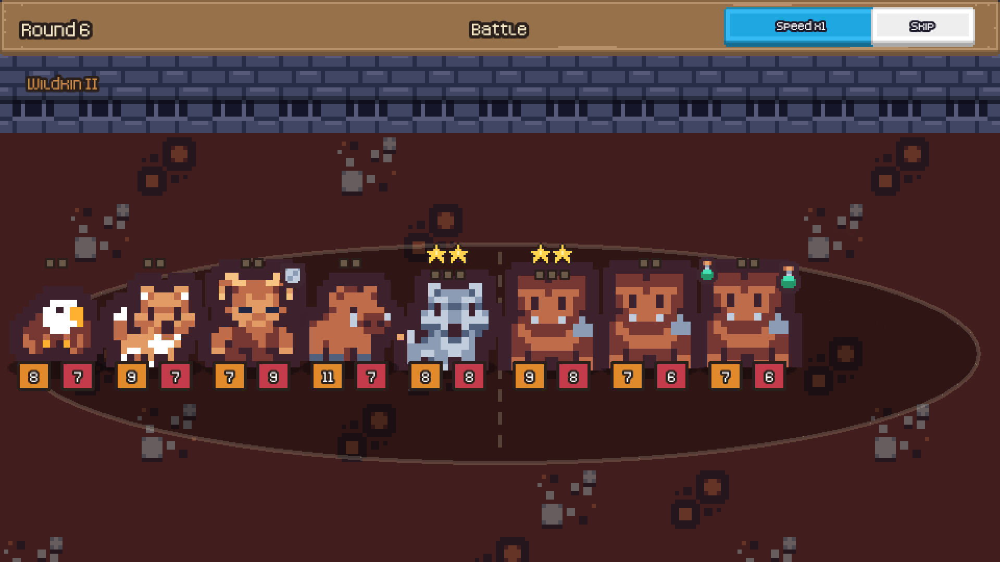

# Beast Tourney

[](https://github.com/ducampcarlos/beast-tourney/actions/workflows/ci.yml)

[](LICENSE)
[](CREDITS.md)

**A fantasy creature auto-battler for the browser.** Buy beasts, merge copies into stronger forms, awaken faction bonds, equip relics, then watch your team fight through a 12-round tournament with three bosses. Pixel art, music, touch and mouse, no install.

<p align="center"></p>

> **Play it:** `https://ducampcarlos.github.io/beast-tourney/` once GitHub Pages is switched on for this repository (Settings → Pages → Deploy from a branch → `main` / `docs`). Or run it locally in a minute, see below.

## How it plays

Each turn you get 10 gold. Spend it in the shop, then press **Fight**: the two teams clash front against front, automatically, and the animations play out every blow, ability and fall.

- **Buy and place.** Drag a creature (3 gold) onto your board of five slots, or double-click it. Roll for new offers (1 gold). Freeze an offer with its padlock to keep it for next turn. Sell by dragging onto the shop.
- **Merge.** Drop a creature onto another of the same kind: it grows +1/+1 and absorbs its experience. Three copies make a **level 2** (a new form, and every ability number doubles), six make a **level 3**.
- **Bond.** Field 2 or 4 *different* creatures of the same faction for a team-wide bonus. There are seven factions: the pack-hunting **Wildkin**, the resurrecting **Undead**, shielded **Elementals**, ever-growing **Fae**, fire-breathing **Dragonkin**, gold-hoarding **Horde** and the well-equipped **Order**.
- **Equip.** Eleven relics, one per creature: a barrier, venom, a returning phoenix tear, thorns, a rallying blade.
- **Fight.** Abilities fire at battle start, when hurt, on a kill, on fainting, when an ally faints, and, in the shop, on sell and at the start of a turn. A **barrier** cancels the next hit; **venom** makes a creature's attacks lethal.
- **Survive.** Win rounds, beat the bosses on rounds 4, 8 and 12 (the Goblin King, the Lich Lord, the Elder Dragon), and lose no more lives than your rank allows.

<p align="center"> </p>

**Everything else:** 46 creatures with flavour text and three levels each (21 of them evolve into a new sprite), a **Bestiary** that fills in as you meet them, three ranks (Squire, Knight, Champion), a **Daily Run** with the same seed for everybody, runs you can resume after closing the tab, speed control and skip in battle, and a layout that fits any screen.

| Controls | |
| --- | --- |
| Drag and drop | buy, move, merge, sell, equip |
| Double-click / double-tap an offer | quick buy |
| `R` | roll |
| `F` | fight |
| `Space` in battle | cycle speed (x1, x2, x4) |
| `Esc` in battle | skip to the result |

## Run it

```bash
git clone https://github.com/ducampcarlos/beast-tourney.git
cd beast-tourney
npm ci
npm run dev        # builds, watches and serves http://localhost:8000
```

`npm run build` writes `docs/game.js`; the rest of `docs/` is the site itself, which is why GitHub Pages can serve it as it is. URL options: `?seed=1234` makes **New Run** use that seed (the same seed always deals the same shops and meets the same opponents), `?debug` exposes the game to the tests, `?nohelp` skips the first-run panel.

## How it is built

```
src/engine/   the rules: pure TypeScript, no Phaser, no DOM, no clock
  data.ts       46 creatures, 7 factions with their bonds, 11 relics, bosses
  battle.ts     the fight: effects, triggers, statuses, bonds, revival; returns an event log
  run.ts        the shop, merging, gold, the ladder; every command returns a new state
  enemy.ts      opponents, generated from the seed and scaled to a power curve
  save.ts       saves, validated field by field on load
src/web/      the Phaser 3 client: scenes (menu, shop, battle, end, bestiary), drag and drop, effects, audio
src/sim/      bots that play full runs, and the balance report
```

- **The engine knows nothing about drawing.** A battle comes back as a list of events (`clash`, `damage`, `buff`, `faint`, `summon`...) with a snapshot of both teams after each step, and the battle scene simply replays it: tweens, projectiles, floating numbers, particles. That is also what makes everything below testable without a browser.
- **Deterministic.** The seed fixes the shops, the opponents and every random target in every fight. Commands never mutate their input, so a run can be undone, replayed, saved or shared as a seed.
- **Opponents are generated, not recorded.** There is no server, so each round's enemy team is picked from the seed and then *scaled to a target power curve* (the sum of attack and health), with bosses as fixed casts. A lucky draw of high-tier creatures cannot spike a round.
- **Balanced with data, not by feel.** `npm run balance` plays thousands of full runs with a bot and prints win rates per rank, how far runs get and how each creature performs. That is how the power curve was set, how the Fae were taken down a peg (they were winning 61-75% of their battles) and how summoners that never had room to summon were found. Over 2000 runs per rank, a decent bot wins the tournament about **55% of the time on Squire, 20% on Knight and 3% on Champion**, and loses fewer than one in ten of its first three fights on Squire. The balance tests pin those bands so a content change cannot quietly break them.

## Tests

```bash
npm test            # 99 tests: rules, shop, enemies, saves, content integrity, bots, balance bands
npm run test:e2e    # 28 end-to-end tests in a real Chromium (needs: npm run build)
```

The unit tests cover every ability trigger and effect, each status, each bond, merging and levelling, selling, freezing, relics, the whole ladder (including losing the final and drawing), determinism, and save tampering (28 kinds of impossible values are refused). A fuzz test throws up to 6,000 random commands at the shop and 1,500 random fights at the battle engine and checks the invariants hold. The end-to-end tests drive the real built game with a real mouse and a real finger: dragging to buy, merge, sell and equip, double-tap, a battle played in real time, a lost run, a won tournament, resuming after a reload, a corrupted save, the sound setting, and canvases from phone to 1080p.

## Limitations

- Opponents are generated, there is no online play and no leaderboard.
- Tested in Chromium. Firefox and Safari should work (Phaser supports them) but have not been run through the suite.
- The layout is landscape first. On a phone held upright the game is small and asks you to turn it sideways.
- Browsers keep audio silent until the first click or tap.

## Credits and license

The code is MIT. The art, fonts, sound effects and music are all CC0 and come from [Kenney](https://kenney.nl) and [OpenGameArt](https://opengameart.org); [CREDITS.md](CREDITS.md) lists every pack, its author and its page. No Pokémon or other trademarked characters appear in this project: the creatures, names and abilities are original, which also means it can stay public without a takedown notice waiting for it.
